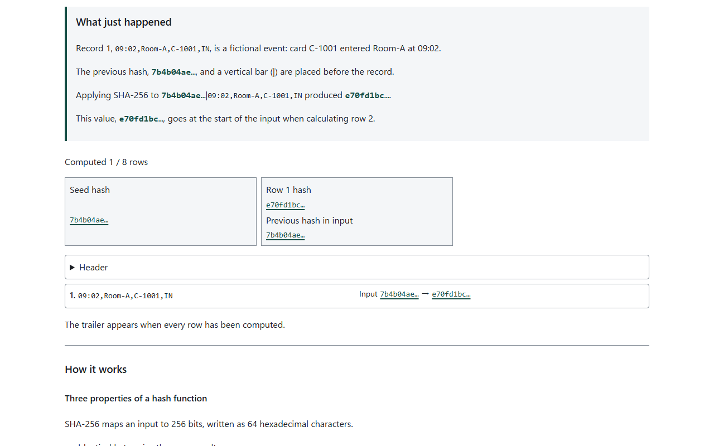
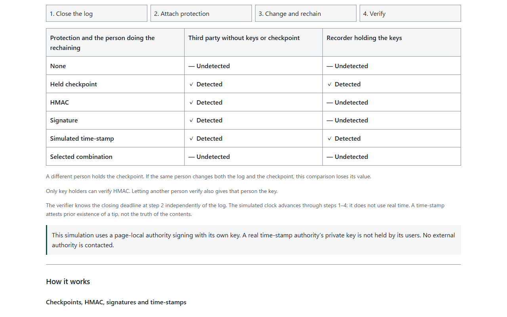
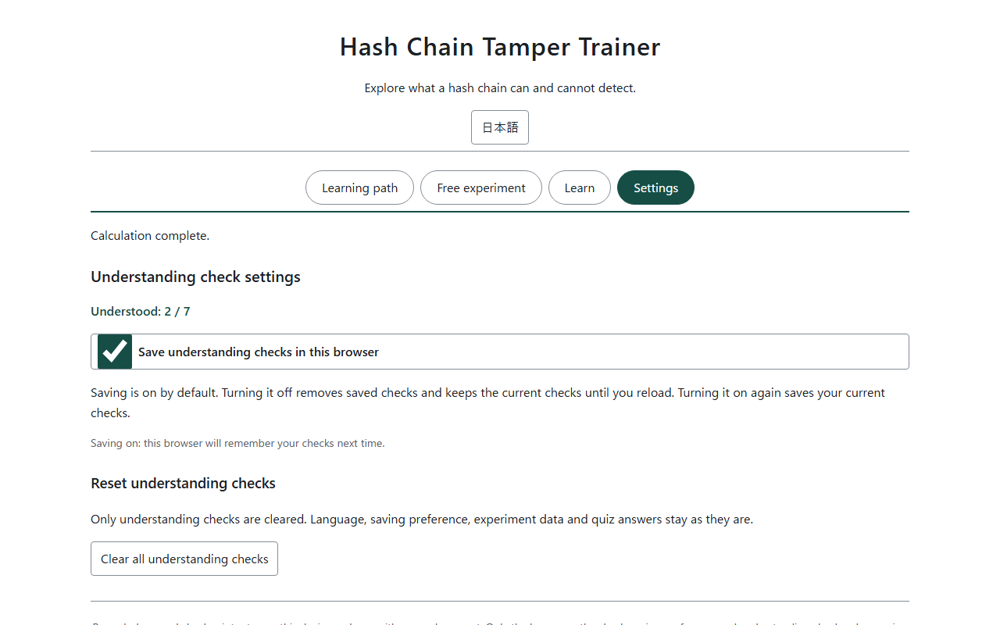

English · [日本語](README.md)

# Hash Chain Tamper Trainer - Learn tampering and rechaining


[](https://ipusiron.github.io/hash-chain-tamper-trainer/)

**Day117 - 200 Security Tools with Generative AI**

Hash Chain Tamper Trainer explores what a hash chain can and cannot detect.
Change fictional records and recompute the following hashes to see verification pass again. The tool also computes the outcomes of adding a held checkpoint, HMAC, a signature or a time-stamp for people with different access to keys.

## 🌐 Demo

👉 **[Open Hash Chain Tamper Trainer](https://ipusiron.github.io/hash-chain-tamper-trainer/)**

Download the files and open `index.html` in a browser to use it over file://. No installation or build is required.

## 📸 Screenshots



*Step 1 explains the fictional record and uses the calculated hashes in What just happened to follow each row.*



*Step 6 compares computed protection outcomes for an outsider and the recorder.*



*View the understood count, change whether checks are saved, or clear all understanding checks.*

## ✨ Features

| Entrance | Content |
|---|---|
| Learning path | Seven steps with an aim, open prerequisites, an action, What just happened, How it works and What you learned; from a one-character change to protections and questions |
| Free experiment | Two samples, row additions, seven modifications, all 16 protection combinations and computation details |
| Learn | Four advanced and reference sections: Lamport chains; Git, Merkle trees and blockchains; the Day041 case study; references |
| Settings | Save preferences and clear all understanding checks |

Japanese, English, and light and dark themes are supported. Language changes preserve inputs, results, answers and understanding checks. Arrow keys, Home and End navigate entrances and steps. The understood count is separate from the current step number.

## 📖 Usage

Step 1 pairs an illustration of card access with four labeled fields to explain one entry/exit record.

The Learning path opens first. Read the aim and prerequisites, then use the main button. What just happened includes calculated hashes and verification results. Read How it works and What you learned below for the reasons. Prerequisites are open from the start and include links to related tools.

1. Build a chain: read what the fictional access log and starting hash mean, then calculate one row at a time. Follow the explanations of each input and hash, ending with the trailer that includes the row count.
2. Change one character: change row 2 from 09:05 to 09:06, see the mismatch at row 2 and inspect changed hash digits.
3. Recompute just that row: recalculate row 2 of the same record and observe the first mismatch move to row 3.
4. Rebuild all later hashes: rechain the modified record and compare the failing step-3 result with the passing step-4 result.
5. Cut off the tail: remove the last two original rows and compare verification with and without a trailer.
6. Add protections: select checkboxes and compare the outsider with the recorder.
7. Check your understanding: answer eight questions. Questions 1–6 lead to explanations within the relevant step; questions 7–8 lead to Learn. Both destinations let you return to the same question.

Use Next, Back or the step bar to jump freely. On narrow screens, open Choose a step. Steps 2–4 continue the same record and provide a reset button. Starting at a later step prepares the preceding records as needed.

Each section heading has its own "I understand" checkbox. The aim, prerequisites, task, observation, individual explanation headings and takeaway form 44 independent sections across the seven steps. Checked sections have a green background and an Understood label. Actions and quiz answers never check them automatically, and you can move on without checking them. The step list shows partial counts for each step.

Related tools have link buttons labeled "Open tool (new tab)" in the prerequisites and at the end of the corresponding explanation.

In Settings, "Save understanding checks in this browser" is on by default. Turning it off removes saved checks while retaining the current checks until you reload. Turning it back on saves the current checks. "Clear all understanding checks" asks for confirmation and clears only the checks, preserving the language, saving preference, experiment data and quiz answers. Cancel or Esc dismisses the confirmation. Previous whole-step checks remain listed in Settings; individual section checks start unchecked. Clearing all checks also clears those previous records.

Free experiment provides build, tamper and protection experiments. Changing sample, header or trailer settings rebuilds the original chain; each modification begins from its copy. Protection comparisons use a common row-2 rewrite. These records are independent of the Learning path.

## 🔬 Chain format and verification results

The seed is SHA-256 of the header lines joined with LF. Excluding the header uses 64 zeros instead. Each row hashes `previousHash + '|' + fields.join(',')`; the trailer hashes `lastHash + '|rows=' + count`.

Hashes have 64 hexadecimal characters. Step 1 explanations and rows show the first 8 followed by an ellipsis. Other compact rows show the first 8 characters of the preceding hash and the first 12 of the current hash. Expanding a row reveals the complete value. Records contain 4 ASCII fields of 1–64 characters each, up to 100 rows. Commas, pipes and control characters are rejected. Whitespace is not trimmed and Unicode is not normalized. HMAC mode retains the SHA-256 seed and uses HMAC-SHA256 for data rows and the trailer.

The following results use the 8-row access log with its header and trailer. Operations target row 2; truncation removes the last 2 rows. A `-` means the remaining rows match but the original trailer does not. `pass` means verification succeeds after rechaining.

| Operation ID | Operation | First mismatching row | After rechaining |
|---|---|---|---|
| `rewrite` | Rewrite | 2 | pass |
| `delete` | Delete | 2 | pass |
| `swap` | Swap with the next row | 2 | pass |
| `insert` | Insert | 2 | pass |
| `truncate` | Remove the last 2 rows | - | pass |
| `header` | Rewrite the header | 1 | pass |
| `rehashOne` | Recompute only the rewritten row | 3 | pass |

Without a trailer, removing the last 2 rows passes. Rewriting and recomputing only the last row also passes without a trailer. A header excluded from the chain can change undetected. Different modifications can produce the same verification result, so the tool does not infer the modification type.

In the next table, ○ means detected and × means undetected. A different person holds the checkpoint. For time-stamps, the verifier knows the closing deadline independently of the log.

| Protection ID | Protection | Outsider without keys or checkpoint | Recorder holding the keys |
|---|---|---|---|
| `none` | None | × | × |
| `checkpoint` | Held checkpoint | ○ | ○ |
| `hmac` | HMAC-SHA256 | ○ | × |
| `signature` | ECDSA P-256 signature | ○ | × |
| `timestamp` | Simulated time-stamp | ○ | ○ |

All 16 protection combinations are available. HMAC plus a signature still lets the recorder rechain successfully; adding an independently held checkpoint detects the change.

## 🎯 Use cases

Three ways to explore the tool's core behavior are:

- An experiment notebook keeper removes 2 of 8 rows and compares the result with and without a trailer, separating internal consistency from evidence that a log was closed.
- A collaborative editing team chooses HMAC and a signature, observes detection for an outsider but not the recorder, and translates the result into a question about who has the authority to compute new values.
- A person managing submission deadlines opens the 4-step trace and sees a correctly signed step-3 token fail the step-2 deadline, separating content truth from prior existence.

Other uses include classroom demonstrations, reviewing record designs at work, learning how household notes could be linked, hobby programming and research discussions. Related tools can help explain hash types and signing keys. These experiments use fictional records and do not determine the truth of real records.

## ⚠️ Limits and assumptions

Anyone who knows the public construction can rechain the records. The exercise demonstrates why a hash chain alone does not prove the absence of tampering.

- A person who can replace both the log and its checkpoint defeats that comparison.
- Only HMAC key holders can verify it. Sharing the key also lets the recipient rechain.
- A recorder holding the signing key can sign a new tip.
- A time-stamp attests prior existence of a tip, not the truth of its contents.
- The simulated authority signs using a key inside the page. A real authority's private key is not held by its users.
- The verifier independently knows the closing deadline. The simulated clock uses steps 1–4, not real time.
- File import and Day041 CSV v3 verification are planned for the second installment and are not implemented here.

IPUSIRON writes technical books about security. The author does not encourage misuse of this tool.

## 🔒 Privacy and security

Records, keys and checkpoints stay on the device and are neither saved nor sent. Reloading the page clears them. localStorage stores the language choice under `hash-chain-tamper-trainer.lang`, and the saving preference and checks when saving is on under `hash-chain-tamper-trainer.learning`. The current step number, calculation results and quiz answers are not saved. The app does not use sessionStorage, cookies or IndexedDB.

If storage is unavailable, checks still work on the current page and a saving failure is shown. Invalid saved data is ignored and all checks start unchecked. If updating storage fails, reloading may restore previously saved checks.

Web Crypto performs SHA-256, HMAC and ECDSA P-256 operations. Private and HMAC keys are generated as non-extractable and are never displayed. All computations, including the simulated time-stamp authority, stay on the device. No external authority or blockchain is contacted.

CSP includes `connect-src 'none'`; the DOM is built with `textContent` and `createElement`. There are no CDNs, external fonts or package dependencies. Opening a reference link yourself navigates to that external site.

## 🔗 References and related tools

Each step links the references for its explanation. The references section in Learn lists all 18, including works discussed in the steps.

- [CyberGhost — Hash Chain](https://www.cyberghostvpn.com/en_US/glossary/hash-chain)
- [Haber & Stornetta (1991), How to time-stamp a digital document](https://doi.org/10.1007/BF00196791)
- [Haber & Stornetta, CRYPTO 1990](https://doi.org/10.1007/3-540-38424-3_32)
- [Schneier & Kelsey (1998), Cryptographic Support for Secure Logs on Untrusted Machines](https://www.usenix.org/conference/7th-usenix-security-symposium/cryptographic-support-secure-logs-untrusted-machines)
- [Schneier & Kelsey (1999), Secure audit logs to support computer forensics](https://doi.org/10.1145/317087.317089)
- [Crosby & Wallach (2009), Efficient Data Structures for Tamper-Evident Logging](https://www.usenix.org/conference/usenixsecurity09/technical-sessions/presentation/efficient-data-structures-tamper-evident)
- [Lamport (1981), Password authentication with insecure communication](https://doi.org/10.1145/358790.358797)
- [RFC 1760 — The S/KEY One-Time Password System](https://www.rfc-editor.org/rfc/rfc1760)
- [RFC 2289 — A One-Time Password System](https://www.rfc-editor.org/rfc/rfc2289)
- [RFC 3161 — Internet X.509 Public Key Infrastructure Time-Stamp Protocol](https://www.rfc-editor.org/rfc/rfc3161)
- [RFC 5816 — ESSCertIDv2 Update for RFC 3161](https://www.rfc-editor.org/rfc/rfc5816)
- [RFC 6962 — Certificate Transparency](https://www.rfc-editor.org/rfc/rfc6962)
- [RFC 9162 — Certificate Transparency Version 2.0](https://www.rfc-editor.org/rfc/rfc9162)
- [Pro Git 10.2 — Git Objects](https://git-scm.com/book/en/v2/Git-Internals-Git-Objects)
- [Pro Git 7.6 — Rewriting History](https://git-scm.com/book/en/v2/Git-Tools-Rewriting-History)
- [Day041 Mic Gain Logger — CSV](https://github.com/ipusiron/mic-gain-logger/blob/main/docs/csv.md)
- [FIPS 180-4 — Secure Hash Standard](https://doi.org/10.6028/NIST.FIPS.180-4)
- [RFC 4231 — HMAC-SHA test vectors](https://www.rfc-editor.org/rfc/rfc4231)

- [Day002 Hash Identifier](https://ipusiron.github.io/hash-detector/): Hash string formats
- [Day031 Git Secrets Playground](https://ipusiron.github.io/git-secrets-playground/): Computing Git objects
- [Day041 Mic Gain Logger](https://ipusiron.github.io/mic-gain-logger/): Logs and a rechaining case study
- [Day052 BaseXX Visualizer](https://ipusiron.github.io/basexx-visualizer/): Encoding byte sequences
- [Day053 JWT Inspector](https://ipusiron.github.io/jwt-inspector/): HMAC and signature verification
- [Day056 HashViz](https://ipusiron.github.io/hashviz/): Avalanche effect and collisions
- [Day114 Hex Dump Trainer](https://ipusiron.github.io/hex-dump-trainer/): Hexadecimal and bytes
- [Day029 OTP Animation](https://ipusiron.github.io/otp-animation/): One-time pad, distinct from the Lamport construction

## 🧪 Tests

Use Node 22 or later without installing dependencies.

```sh
npm test
node --check chain-core.js
node --check app.js
```

Tests cover cryptographic known answers, sample vectors independently generated with Python hashlib, 7 modifications, final-row exceptions, protection and role combinations, and all 16 protection selections. They also check HTML, CSP, both dictionaries, contrast, seven step explanations, four Learn sections, quiz destinations, and README tables and images. GitHub Actions checks every JavaScript file's syntax and runs `npm test` on push and pull_request.

## 📁 Directory structure

```text
hash-chain-tamper-trainer/        # Project root
├── .github/                      # GitHub configuration
│   └── workflows/                # Automated checks
│       └── test.yml              # Syntax and tests
├── .gitignore                    # Git exclusions
├── CLAUDE.md                     # Developer guide
├── LICENSE                       # MIT license
├── README.en.md                  # English documentation
├── README.md                     # Japanese documentation
├── app.js                        # Interface and interactions
├── assets/                       # Screenshots and illustration
│   ├── access-entry.webp         # Card access illustration
│   ├── chain.png                 # Chain view
│   ├── en/                       # English screenshots
│   │   ├── chain.png             # Chain view
│   │   ├── protections.png       # Protection and role table
│   │   └── settings.png          # Understanding check settings
│   ├── protections.png           # Protection and role table
│   ├── settings.png              # Understanding check settings
│   └── tamper.png                # Tampering result
├── chain-core.js                 # Chain and cryptography
├── index.html                    # Four entrances and seven guided steps
├── learning-progress.js          # Understanding checks and persistence
├── messages.js                   # Japanese and English text
├── package.json                  # Test command
├── samples.js                    # Two fictional samples
├── style.css                     # Layout and light/dark colors
└── test/                         # Automated tests
    ├── chain-vectors.json        # Independent chain vectors
    ├── chain.test.js             # Chain and tampering checks
    ├── contrast.test.js          # Contrast checks
    ├── html.test.js              # HTML and CSP checks
    ├── i18n.test.js              # Dictionary and wording checks
    ├── learning-progress.test.js # Understanding and storage checks
    ├── learning.test.js          # Lesson and quiz checks
    ├── protections.test.js       # Protection and role checks
    └── readme.test.js            # Documentation consistency
```

## 💻 Requirements

Use a browser with JavaScript and Web Crypto support for SHA-256, HMAC and ECDSA P-256. HTTPS, local HTTP and file:// are checked.

| Engine | Checked coverage |
|---|---|
| Chromium 145 | HTTP and file://, widths 320, 390 and 1280px, Japanese and English |
| Firefox 146 | HTTP and file://, widths 320 and 1280px, Japanese |
| WebKit 26.0 | HTTP and file://, width 390px, Japanese and English |

Physical Safari, physical smartphones and screen-reader speech are unverified. Environments without Web Crypto show an explanation and disable computation.

## 📄 License

Source code is licensed under the [MIT License](LICENSE). Quoted passages and referenced works remain the property of their respective authors.

## 🛠️ About this tool

This tool is part of the 200 Security Tools with Generative AI project.
The project uses AI assistance to create and publish a variety of security tools over 100 days.

See the [project page](https://akademeia.info/?page_id=44607) for details and other tools.
