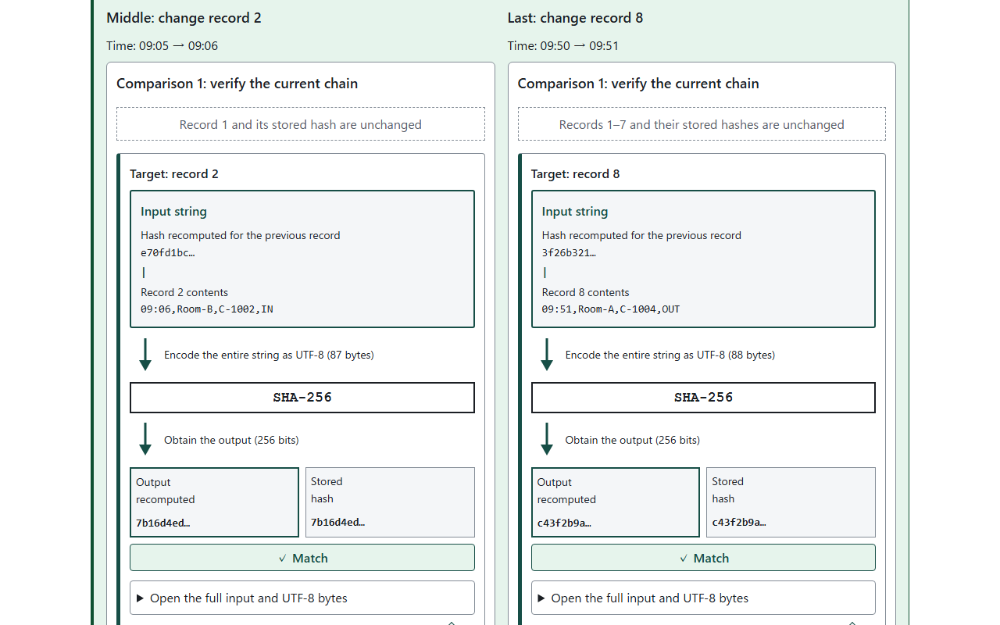

English · [日本語](README.md)

# Hash Chain Tamper Trainer - Learn tampering and rechaining


[](https://ipusiron.github.io/hash-chain-tamper-trainer/)

**Day117 - 200 Security Tools with Generative AI**

Hash Chain Tamper Trainer explores what a hash chain can and cannot detect. A hash is the output of a hash function.

This tool keeps records with their corresponding hashes and compares them with recomputed hashes. The overview in step 1 shows the data structure and the roles of the recorder, verifier and independent checkpoint holder.

Change fictional records and recompute the following hashes to see verification pass again. The tool also computes the outcomes of adding a held checkpoint, HMAC, a signature or a time-stamp for people with different access to keys.

## 🌐 Demo

👉 **[Open Hash Chain Tamper Trainer](https://ipusiron.github.io/hash-chain-tamper-trainer/)**

Download the files and open `index.html` in a browser to use it over file://. No installation or build is required.

## 📸 Screenshots


*Step 1 after calculating the hash for record 1. Inspect the actual input and output, and expand the input to read every UTF-8 byte.*


*Select a step-6 verdict to inspect who holds the keys and evidence, the compared values, and the reason for the result.*


*View the understood count, change whether checks are saved, or clear all understanding checks.*



*Step 3 connects input, UTF-8 encoding, SHA-256 and output, then compares the output with the stored hash. Equal values share green; different values use blue on the left or above and orange on the right or below. Each hash is compared as one complete 64-character value, without highlighting coincidentally equal characters. Input comparisons distinguish the previous hash and each record field.*

## ✨ Features

| Entrance | Content |
|---|---|
| Learning path | Seven steps with an aim, open prerequisites, an action, What just happened, How it works and What you learned; from a one-character change through middle/last comparison to protections and questions |
| Free experiment | Two samples, row additions, seven modifications, all 16 protection combinations and computation details |
| Learn | Four advanced and reference sections: Lamport chains; Git, Merkle trees and blockchains; the Day041 case study; references |
| Settings | Save preferences and clear all understanding checks |

Japanese, English, and light and dark themes are supported. Language changes preserve inputs, results, answers and understanding checks. Arrow keys, Home and End navigate entrances and steps. The understood count is separate from the current step number.

## 📖 Usage

Step 1 starts with the card-access illustration and a visible diagram separating the record, calculation input string, and output hash. It introduces the record/hash pair, the hash recalculated during verification, and the difference between comparing and updating. Record 1’s output appears only after its calculation button is pressed. Expand the supporting material to inspect the format and data overview: the header, eight record/hash pairs, the trailer and an independently held checkpoint. Pending hashes are replaced by actual results as you calculate. After all eight calculations, use Return to the completed data overview to inspect the finished structure.

Each step has a dedicated diagram below its aim. Step 1 connects the output hash directly to the next input. Steps 2–4 distinguish input construction, calculation, replacement of stored hashes, and verification recomputation, tracing both comparison operands to their sources. Step 5 removes records 7–8 together with their hashes while retaining the original eight-record trailer. Step 6 shows each rebuilder’s available keys and the data handed to verification. Step 7 separates comparisons of record hashes, trailers and independent checkpoints. Actual hashes and results appear after the action.

The Learning path opens first. Read the aim and prerequisites, then use the main button. What just happened includes calculated hashes and verification results. Read How it works and What you learned below for the reasons. Brief prerequisites are visible from the start; expand the supporting explanation and related tools in place. Steps 1–6 offer optional predictions that you can compare with the result. Predictions and disclosure states are not saved.

1. Build a chain: calculate the hash for each of records 1–8. Inspect the stored pairs in the overview and distinguish the input string, UTF-8 bytes and output in the calculation diagram. Finish with the trailer and the final hash/trailer pair to keep as an independent checkpoint. Restart from record 1 at any time.
2. Change one character: change the time in record 2 from 09:05 to 09:06 and verify while retaining the stored hashes. Compare the original chain’s hashes with hashes recalculated from the changed records, record by record. Expand any record to compare all 64 characters.
3. Update only the hash for the changed record: calculate from the input containing the changed record 2 and replace its stored hash. The first mismatch moves to record 3. A propagation diagram shows how its input prefix changes while its four record fields stay the same. Then use the input/output diagram and real values to compare the same action on the last record, 8.
4. Rebuild all later hashes: replace all hashes and the trailer. See verification pass with the changed records and expand the step-3 comparison. A note beside the result distinguishes internal consistency from being unchanged since the original log.
5. Cut off the tail: remove original records 7 and 8. The six remaining hashes match, but comparison with the original trailer fails. Compare the eight-record and six-record inputs and trailers, then also rebuild the trailer for six records.
6. Add protections: select a held checkpoint, HMAC, a signature or a simulated time-stamp. Compare an outsider with the key-holding recorder. Test the checkpoint role introduced in the step-1 overview. Select any verdict to inspect available keys and detection evidence.
7. Check your understanding: answer eight questions. Questions 1–6 cover the core experiments and lead to explanations within the relevant step; questions 7–8 cover advanced topics and lead to Learn. Both destinations let you return to the same question.

Use Next, Back or the step bar to jump freely. On narrow screens, open Choose a step. Steps 2–4 continue the same record and provide a reset button. Starting at a later step prepares the preceding records as needed.

Each step’s aim identifies the records, the specific edit, and the values to compare, so the experiment’s conditions are clear even when you start at that step. Each step distinguishes changing a record, updating its stored hash, and comparing values during verification. The trailer example keeps the original trailer for comparison, and the protection examples identify who holds the keys and the independent checkpoint.

Each section heading has its own "I understand" checkbox. The aim, prerequisites, task, observation, individual explanation headings and takeaway form 44 independent sections across the seven steps. Checked sections have a green background and an Understood label. Actions and quiz answers never check them automatically, and you can move on without checking them. The step list shows partial counts for each step. Each heading includes a criterion describing what you should be able to explain.

Related tools have link buttons labeled "Open tool (new tab)" in the prerequisites and at the end of the corresponding explanation.

The takeaway is always visible as a summary, including before the action. A note identifies the preview before execution. Every section can be checked independently of actions, so checking all headings completes that step’s count. Experiment results and quiz answers never check sections automatically.

Step 5 deletes records 7–8 and their stored hashes from the original log. It separates checking the six remaining record hashes from also checking the retained eight-record trailer. A trailer hashes the last hash and count; the six-record and original eight-record trailers are compared. Question 1 specifies record 2’s 09:05→09:06 alteration and replacement of stored hashes for records 2–8 and the trailer.

In Settings, "Save understanding checks in this browser" is on by default. Turning it off removes saved checks while retaining the current checks until you reload. Turning it back on saves the current checks. "Clear all understanding checks" asks for confirmation and clears only the checks, preserving the language, saving preference, experiment data and quiz answers. Cancel or Esc dismisses the confirmation. Previous whole-step checks remain listed in Settings; individual section checks start unchecked. Clearing all checks also clears those previous records.

Free experiment provides build, tamper and protection experiments. Changing sample, header or trailer settings rebuilds the original chain; each modification begins from its copy. Protection comparisons use a common row-2 rewrite. These records are independent of the Learning path. Verification pairs each stored hash with its recalculated hash. Expand a record to inspect the actual verification input and the hash produced from that input.

A side-by-side example connects the short display to all 64 characters, with the first 8 underlined. The calculation diagram separates the previous hash, separator and current record, and shows the actual input and output. Opening the exact input also shows every UTF-8 byte directly below it, with the byte count and character-to-byte examples.

Diagrams show the status of all 8 rows, tail deletion, and the people who hold keys or independent copies. All four advanced sections have worked examples, and explanatory prose is divided into paragraphs by topic.

Step 3 embeds the Middle vs last input/output diagrams in What just happened. Arrows connect each input string, UTF-8 encoding, SHA-256 and output. The output and stored hash appear side by side, with callouts explaining each match or mismatch. Arrows also show the output feeding the next record or trailer input. Expand the full input and every byte in place. Two original copies let you replay 0 original, 1 change only the contents, and 2 also update that record’s stored hash. It opens at stage 2, matching the Step 3 action; stage 1 revisits Step 2.

Within each diagram, the complete hash cells, including their labels, are colored. A match makes both green; a mismatch makes the output blue and the stored hash orange. A solid verdict bar and an orange record or trailer outline emphasize a mismatch. These colors compare the two hashes within each diagram, not record 2 against record 8.

Toggle whether the original trailer is included. At stage 2, both target records match, but record 3 mismatches in the middle case and the original trailer mismatches in the last-record case. Excluding the trailer lets the last-record case pass without making it identical to the original. A separate comparison below each diagram shows changes from the original; expand all eight inputs and full hashes for details.

Return to this step’s comparison restores stage 2 with the original trailer included. These controls do not change the record-2 experiment carried into Step 4. Continue to Step 4 to update the stored hashes for records 3–8 and the trailer as well.

In the explanations for Steps 2 and 3, “Compare middle and last here” opens the same diagrams directly below the button. It preserves the current step, experiment results and scroll position. Keyboard focus also stays on the button. Press it again to close. Its stage and trailer selections are independent of the comparison in the Step 3 result.

## 🔬 Chain format and verification results

This tool keeps records paired with their corresponding hashes, as shown below. This is a content structure, not a universal CSV or JSON specification. File formats, storage locations and access policies are deployment choices; neither records nor hashes need to be made public.

```plaintext
Bundle held by the recorder
  Header                    Record type, start time, etc.
  Record 1 + its hash
  Record 2 + its hash
  ...
  Record 8 + its hash
  Trailer                   Check of the count and ending
```

| Role | What is kept, received or compared |
|---|---|
| Recorder | Keeps the bundle above and gives it to the verifier |
| Verifier | Receives the bundle, recomputes from the header onward, and compares with the received hashes and trailer |
| Independent checkpoint holder (step 6) | Separately keeps the final hash and trailer, including the count, at log closure; the verifier compares each current value with its original counterpart |

Keeping a checkpoint beside the records is insufficient if the person changing the records can replace it too. Step 6 assumes a different person holds the checkpoint. HMAC, signatures and time-stamps also depend on who holds keys and whether the verifier independently knows the closing time.

This tool simulates all roles in the same browser. It does not send data to another person or save it as a file.

**The stored record is distinct from the calculation input.** Record 2 contains the four fields in `09:05,Room-B,C-1002,IN`. Its input also includes the 64-character hash for record 1 and the separator `|`. Encode the complete joined string as UTF-8 bytes and pass it to SHA-256 to obtain the hash for record 2.

The seed is SHA-256 of the header lines joined with LF. Excluding the header uses 64 zeros instead. Each record’s calculation hashes `previousHash + '|' + fields.join(',')`; the trailer hashes `lastHash + '|rows=' + count`.

Hashes have 64 hexadecimal characters. The step-1 overview and result summaries show the first 8 followed by an ellipsis. Other compact rows show the first 8 characters of the preceding hash and the first 12 of the current hash. Expanding a row reveals the complete value. Records contain 4 ASCII fields of 1–64 characters each, up to 100 rows. Commas, pipes and control characters are rejected. Whitespace is not trimmed and Unicode is not normalized. HMAC mode retains the SHA-256 seed and uses HMAC-SHA256 for data rows and the trailer.

The following results use the 8-row access log with its header and trailer. Operations target record 2; truncation removes the last 2 rows. A `-` means the remaining rows match but the original trailer does not. `pass` means verification succeeds after rechaining.

| Operation ID | Operation | First mismatching row | After rechaining |
|---|---|---|---|
| `rewrite` | Rewrite | 2 | pass |
| `delete` | Delete | 2 | pass |
| `swap` | Swap with the next row | 2 | pass |
| `insert` | Insert | 2 | pass |
| `truncate` | Remove the last 2 rows | - | pass |
| `header` | Rewrite the header | 1 | pass |
| `rehashOne` | Update only the hash for the rewritten record | 3 | pass |

Without a trailer, removing the last 2 rows passes.

For the last record, separate changing its contents from replacing its stored hash. Start from the original 8 records and change only record 8, leaving records 1–7 and the original trailer unchanged. A represents the hash from record 8's original input; B represents the hash from its changed input. Assume A ≠ B.

| Operation | Hash stored with record 8 | Hash recomputed during verification | Record 8 comparison |
|---|---|---|---|
| 1. Change only record 8's contents | Still A | B | Mismatch |
| 2. Next, replace its stored hash with the recomputed value | Updated to B | B | Match |

Stage 2 compares the stored B with the recomputed B, not the original A with the changed B. Records 1–7 are unchanged and no record follows record 8, so all record comparisons now pass.

The original trailer was computed from `A|rows=8`. Verification computes it from `B|rows=8`, so retaining the original trailer produces a trailer mismatch. Without a trailer, verification passes. Steps 2 and 3 also show these two stages in a table and diagram.

A header excluded from the chain can change undetected. Different modifications can produce the same verification result, so the tool does not infer the modification type.

In the next table, ○ means detected and × means undetected. A different person holds the checkpoint. For time-stamps, the verifier knows the closing deadline independently of the log.

| Protection ID | Protection | Outsider without keys or checkpoint | Recorder holding the keys |
|---|---|---|---|
| `none` | None | × | × |
| `checkpoint` | Held checkpoint | ○ | ○ |
| `hmac` | HMAC-SHA256 | ○ | × |
| `signature` | ECDSA P-256 signature | ○ | × |
| `timestamp` | Simulated time-stamp | ○ | ○ |

All 16 protection combinations are available. HMAC plus a signature still lets the recorder rechain successfully; adding an independently held checkpoint detects the change.

## 🎯 Use cases

Three ways to explore the tool's core behavior are:

- An experiment notebook keeper removes 2 of 8 rows and compares the result with and without a trailer, separating internal consistency from evidence that a log was closed.
- A collaborative editing team chooses HMAC and a signature, observes detection for an outsider but not the recorder, and translates the result into a question about who has the authority to compute new values.
- A person managing submission deadlines opens the 4-step trace and sees a correctly signed step-3 token fail the step-2 deadline, separating content truth from prior existence.

Other uses include classroom demonstrations, reviewing record designs at work, learning how household notes could be linked, hobby programming and research discussions. Related tools can help explain hash types and signing keys. These experiments use fictional records and do not determine the truth of real records.

## ⚠️ Limits and assumptions

Anyone who knows the public construction can rechain the records. The exercise demonstrates why a hash chain alone does not prove the absence of tampering.

- A person who can replace both the log and its checkpoint defeats that comparison.
- Only HMAC key holders can verify it. Sharing the key also lets the recipient rechain.
- A recorder holding the signing key can sign a new tip.
- A time-stamp attests prior existence of a tip, not the truth of its contents.
- The simulated authority signs using a key inside the page. A real authority's private key is not held by its users.
- The verifier independently knows the closing deadline. The simulated clock uses steps 1–4, not real time.
- File import and Day041 CSV v3 verification are planned for the second installment and are not implemented here.

IPUSIRON writes technical books about security. The author does not encourage misuse of this tool.

## 🔒 Privacy and security

Records, keys and checkpoints stay on the device and are neither saved nor sent. Reloading the page clears them. localStorage stores the language choice under `hash-chain-tamper-trainer.lang`, and the saving preference and checks when saving is on under `hash-chain-tamper-trainer.learning`. The current step number, calculation results and quiz answers are not saved. The app does not use sessionStorage, cookies or IndexedDB.

If storage is unavailable, checks still work on the current page and a saving failure is shown. Invalid saved data is ignored and all checks start unchecked. If updating storage fails, reloading may restore previously saved checks.

Web Crypto performs SHA-256, HMAC and ECDSA P-256 operations. Private and HMAC keys are generated as non-extractable and are never displayed. All computations, including the simulated time-stamp authority, stay on the device. No external authority or blockchain is contacted.

CSP includes `connect-src 'none'`; the DOM is built with `textContent` and `createElement`. There are no CDNs, external fonts or package dependencies. Opening a reference link yourself navigates to that external site.

## 🔗 References and related tools

Each step links the references for its explanation. The references section in Learn lists all 18, including works discussed in the steps.

- [CyberGhost — Hash Chain](https://www.cyberghostvpn.com/en_US/glossary/hash-chain)
- [Haber & Stornetta (1991), How to time-stamp a digital document](https://doi.org/10.1007/BF00196791)
- [Haber & Stornetta, CRYPTO 1990](https://doi.org/10.1007/3-540-38424-3_32)
- [Schneier & Kelsey (1998), Cryptographic Support for Secure Logs on Untrusted Machines](https://www.usenix.org/conference/7th-usenix-security-symposium/cryptographic-support-secure-logs-untrusted-machines)
- [Schneier & Kelsey (1999), Secure audit logs to support computer forensics](https://doi.org/10.1145/317087.317089)
- [Crosby & Wallach (2009), Efficient Data Structures for Tamper-Evident Logging](https://www.usenix.org/conference/usenixsecurity09/technical-sessions/presentation/efficient-data-structures-tamper-evident)
- [Lamport (1981), Password authentication with insecure communication](https://doi.org/10.1145/358790.358797)
- [RFC 1760 — The S/KEY One-Time Password System](https://www.rfc-editor.org/rfc/rfc1760)
- [RFC 2289 — A One-Time Password System](https://www.rfc-editor.org/rfc/rfc2289)
- [RFC 3161 — Internet X.509 Public Key Infrastructure Time-Stamp Protocol](https://www.rfc-editor.org/rfc/rfc3161)
- [RFC 5816 — ESSCertIDv2 Update for RFC 3161](https://www.rfc-editor.org/rfc/rfc5816)
- [RFC 6962 — Certificate Transparency](https://www.rfc-editor.org/rfc/rfc6962)
- [RFC 9162 — Certificate Transparency Version 2.0](https://www.rfc-editor.org/rfc/rfc9162)
- [Pro Git 10.2 — Git Objects](https://git-scm.com/book/en/v2/Git-Internals-Git-Objects)
- [Pro Git 7.6 — Rewriting History](https://git-scm.com/book/en/v2/Git-Tools-Rewriting-History)
- [Day041 Mic Gain Logger — CSV](https://github.com/ipusiron/mic-gain-logger/blob/main/docs/csv.md)
- [FIPS 180-4 — Secure Hash Standard](https://doi.org/10.6028/NIST.FIPS.180-4)
- [RFC 4231 — HMAC-SHA test vectors](https://www.rfc-editor.org/rfc/rfc4231)

- [Day002 Hash Identifier](https://ipusiron.github.io/hash-detector/): Hash string formats
- [Day031 Git Secrets Playground](https://ipusiron.github.io/git-secrets-playground/): Computing Git objects
- [Day041 Mic Gain Logger](https://ipusiron.github.io/mic-gain-logger/): Logs and a rechaining case study
- [Day052 BaseXX Visualizer](https://ipusiron.github.io/basexx-visualizer/): Encoding byte sequences
- [Day053 JWT Inspector](https://ipusiron.github.io/jwt-inspector/): HMAC and signature verification
- [Day056 HashViz](https://ipusiron.github.io/hashviz/): Avalanche effect and collisions
- [Day114 Hex Dump Trainer](https://ipusiron.github.io/hex-dump-trainer/): Hexadecimal and bytes
- [Day029 OTP Animation](https://ipusiron.github.io/otp-animation/): One-time pad, distinct from the Lamport construction

## 🧪 Tests

Use Node 22 or later without installing dependencies.

```sh
npm test
node --check chain-core.js
node --check app.js
```

Tests cover cryptographic known answers, sample vectors independently generated with Python hashlib, 7 modifications, final-row exceptions, protection and role combinations, and all 16 protection selections. They also check HTML, CSP, both dictionaries, contrast, seven step explanations, four Learn sections, quiz destinations, and README tables and images. GitHub Actions checks every JavaScript file's syntax and runs `npm test` on push and pull_request.

## 📁 Directory structure

```text
hash-chain-tamper-trainer/          # Project root
├── .github/                        # GitHub configuration
│   └── workflows/                  # Automated checks
│       └── test.yml                # Syntax and tests
├── .gitignore                      # Git exclusions
├── CLAUDE.md                       # Developer guide
├── LICENSE                         # MIT license
├── README.en.md                    # English documentation
├── README.md                       # Japanese documentation
├── app.js                          # Interface and interactions
├── assets/                         # Screenshots and illustration
│   ├── access-entry.webp           # Card access illustration
│   ├── chain.png                   # Chain view
│   ├── en/                         # English screenshots
│   │   ├── chain.png               # Chain view
│   │   ├── position.png            # Middle versus last comparison
│   │   ├── protections.png         # Protection and role table
│   │   └── settings.png            # Understanding check settings
│   ├── position.png                # Middle versus last comparison
│   ├── protections.png             # Protection and role table
│   ├── settings.png                # Understanding check settings
│   └── tamper.png                  # Tampering result
├── chain-core.js                   # Chain and cryptography
├── index.html                      # Four entrances and seven guided steps
├── learning-progress.js            # Understanding checks and persistence
├── messages.js                     # Japanese and English text
├── package.json                    # Test command
├── samples.js                      # Two fictional samples
├── style.css                       # Layout and light/dark colors
└── test/                           # Automated tests
    ├── chain-vectors.json          # Independent chain vectors
    ├── chain.test.js               # Chain and tampering checks
    ├── contrast.test.js            # Contrast checks
    ├── html.test.js                # HTML and CSP checks
    ├── i18n.test.js                # Dictionary and wording checks
    ├── learning-progress.test.js   # Understanding and storage checks
    ├── learning.test.js            # Lesson and quiz checks
    ├── protections.test.js         # Protection and role checks
    └── readme.test.js              # Documentation consistency
```

## 💻 Requirements

Use a browser with JavaScript and Web Crypto support for SHA-256, HMAC and ECDSA P-256. HTTPS, local HTTP and file:// are checked.

| Engine | Checked coverage |
|---|---|
| Chromium 145 | HTTP and file://, widths 320, 390 and 1280px, Japanese and English |
| Firefox 146 | HTTP and file://, widths 320 and 1280px, Japanese |
| WebKit 26.0 | HTTP and file://, width 390px, Japanese and English |

Physical Safari, physical smartphones and screen-reader speech are unverified. Environments without Web Crypto show an explanation and disable computation.

## 📄 License

Source code is licensed under the [MIT License](LICENSE). Quoted passages and referenced works remain the property of their respective authors.

## 🛠️ About this tool

This tool is part of the 200 Security Tools with Generative AI project.
The project uses AI assistance to create and publish a variety of security tools over 100 days.

See the [project page](https://akademeia.info/?page_id=44607) for details and other tools.
