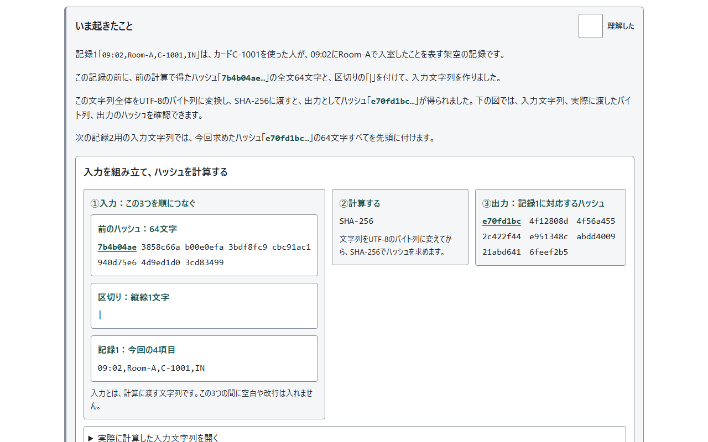
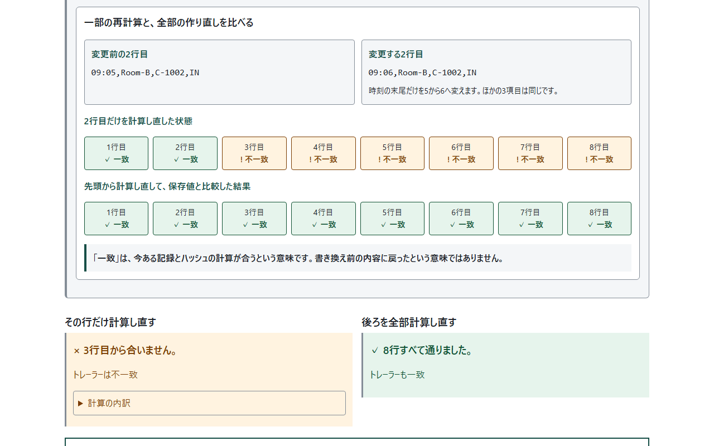
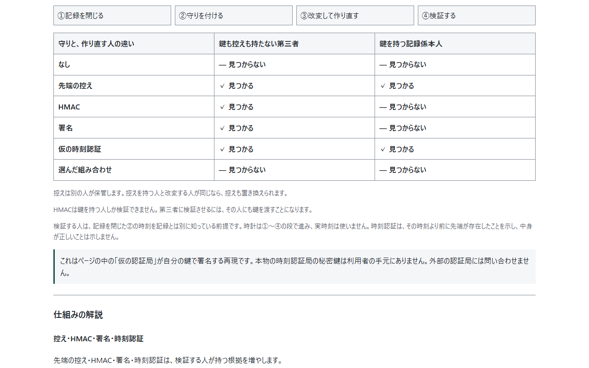
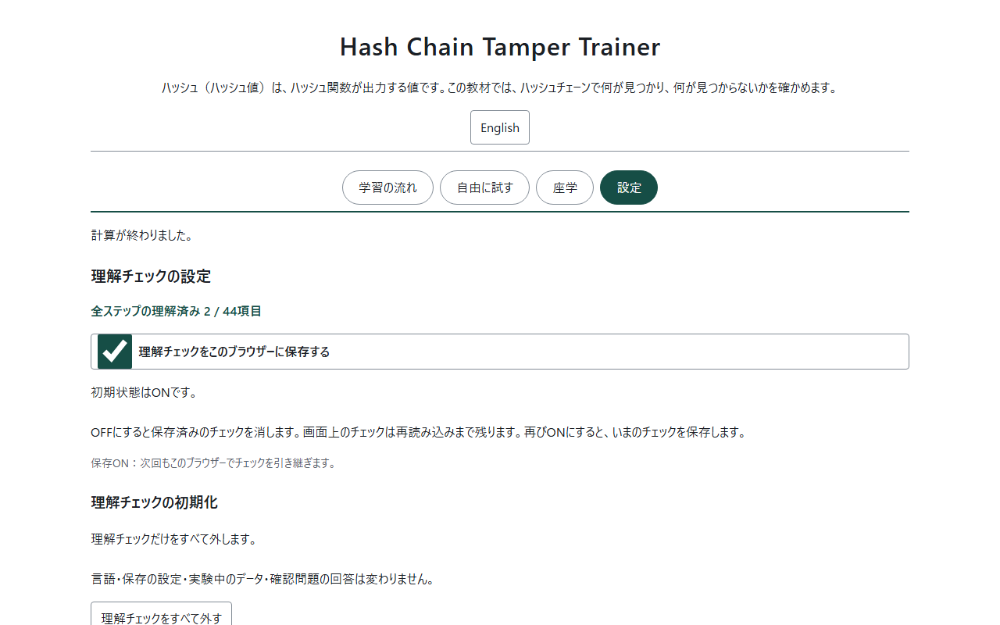

<!--
---
id: day117
slug: hash-chain-tamper-trainer
title: "Hash Chain Tamper Trainer"
subtitle_ja: "ハッシュチェーンの改変と作り直しを学ぶ"
subtitle_en: "Learn tampering and rechaining"
description_ja: "架空の記録を改変し、作り直しと守りの計算からハッシュチェーンの検出範囲を確かめる教材"
description_en: "Explore hash-chain detection by changing fictional records, rechaining them and comparing protections"
category_ja: [ハッシュ関数, フォレンジック]
category_en: [Hash Function, Digital Forensics]
difficulty: 2
tags: [hash-chain, sha256, hmac, digital-signature, timestamp, forensics, offline]
repo_url: "https://github.com/ipusiron/hash-chain-tamper-trainer"
demo_url: "https://ipusiron.github.io/hash-chain-tamper-trainer/"
hub: true
---
-->

# Hash Chain Tamper Trainer - ハッシュチェーンの改変と作り直しを学ぶ


[](https://ipusiron.github.io/hash-chain-tamper-trainer/)

**Day117 - 生成AIで作るセキュリティツール200**

[English](README.en.md) · 日本語

Hash Chain Tamper Trainerは、ハッシュチェーンで何が見つかり、何が見つからないかを確かめる教材です。
架空の記録を書き換え、後ろのハッシュをすべて計算し直す（作り直す）と検証が通ることを体験できます。先端の控え・HMAC・署名・時刻認証を加えた場合も、鍵を持つ人ごとの結果を実際に計算します。

## 🌐 デモページ

👉 **[Hash Chain Tamper Trainerを開く](https://ipusiron.github.io/hash-chain-tamper-trainer/)**

ダウンロードした`index.html`をブラウザーで開くと、file://でも使えます。インストールとビルドは不要です。

## 📸 スクリーンショット



*段1では、架空の記録とハッシュの意味を読み、計算した値を含む「いま起きたこと」で1行ごとの流れを追います。*



*段3は3行目から合わず、段4で全部を作り直すと検証が通ります。2つの結果を並べて示します。*



*段6では、守りと作り直す人による違いを、実際の計算結果で比べます。*



*理解済みの件数を確認し、チェックの保存を切り替えたり、すべて外したりできます。*

## ✨ 機能

| 入口 | 内容 |
|---|---|
| 学習の流れ | 7段すべてにねらい・前提知識・やること・いま起きたこと・仕組みの解説・わかったこと。1文字の変更から守りと確認問題まで |
| 自由に試す | サンプル2種、行の追加、改変7種、守り16通りの組み合わせ、計算の内訳 |
| 座学 | 発展と参考文献の4節。Lamport型、git・マークルツリー・ブロックチェーン、Day041の事例、参考文献 |
| 設定 | 理解チェックの保存切り替えと一括解除 |

日本語・英語と明暗の表示に対応しています。言語を切り替えても入力・計算結果・回答・理解チェックは保持します。入口と手順は矢印キー・Home・Endでも移動できます。理解済みの件数は、表示中のステップ番号と分けて示します。

## 📖 使い方

ステップ1では、カードを使って部屋に入るイラストと4項目の対応図で、入退室の記録1行の意味を確認できます。

最初に開く「学習の流れ」は、次の7段です。各段でねらいと前提知識を読み、主ボタンで操作します。「いま起きたこと」には実際に計算したハッシュや判定が入ります。その下の仕組みの解説と「わかったこと」で理由を読めます。前提知識は最初から表示され、関連ツールのリンクもあります。

1. チェーンを作る：架空の入退室の記録と起点の意味を読み、1行ずつ計算する。全8行の進行図で計算済み・次に計算・未計算を確認し、途中や完成後に1行目からやり直せる。各行の入力とハッシュ、最後の行数を含むトレーラーを説明で確認する。
2. 1カ所だけ書き換える：2行目の時刻を「09:05」から「09:06」に変え、2行目からの不一致と変わったハッシュの桁を確認する。
3. その行だけ計算し直す：同じ記録の2行目だけを再計算し、不一致が3行目へ移ることを確認する。
4. 後ろを全部計算し直す：後ろのハッシュをすべて計算し直す（作り直す）操作を行い、段3の不一致と段4の成功を並べて比べる。
5. 末尾を切り落とす：元の記録から末尾2行を消し、トレーラーなしでは通り、ありでは不一致になることを確認する。
6. 守りを足す：チェックボックスで守りを選び、第三者と記録係本人の結果を比べる。
7. 確かめる：確認問題8問を解く。問題1〜6は関連するステップの解説へ、問題7・8は座学へ移り、元の問題へ戻れる。

「次へ」「戻る」と手順のバーから、いつでも段を選べます。狭い画面では「ステップを選ぶ」を開きます。段2〜4は同じ記録の続きで、元に戻す操作もできます。途中の段から始めた場合は、必要な前の段の記録を用意します。

各段の見出しの横にある「理解した」は、自分で付け外しできます。「ねらい」「前提知識」「やること」「いま起きたこと」、解説の小見出し、「わかったこと」の合計44項目を個別に記録します。理解済みの箇所は背景が緑色になり、「理解済み」と表示されます。操作や解答によって自動でチェックされることはなく、未チェックでも移動できます。一覧には各段の理解済み件数を表示します。

参考ツールは「ツールを開く（別タブ）」と示したリンクボタンから開けます。前提知識と、対応する解説の末尾に配置しています。

「設定」の「理解チェックをこのブラウザーに保存する」は初期状態でONです。OFFにすると保存済みのチェックを消し、画面上のチェックは再読み込みまで残します。再びONにすると現在のチェックを保存します。「理解チェックをすべて外す」は確認後にチェックだけを解除し、言語・保存設定・実験データ・問題の回答を保ちます。キャンセルまたはEscキーで解除を取り消せます。以前のステップ単位のチェックがある場合は設定に記録を残し、見出し別チェックは未チェックで始めます。一括解除では以前の記録も外します。

「自由に試す」では、作る・改変・守りの実験を選べます。サンプル・ヘッダー・トレーラーを変えると元のチェーンを作り直し、改変の各操作はそのコピーに適用します。守りの比較はサンプルの2行目を書き換える共通条件です。学習の流れの記録とは独立しています。

短縮表示と64文字の全文を並べ、先頭8文字の対応を下線で示します。計算の図では「前のハッシュ・縦線・今回の記録」を分け、実際の入力と出力を読めます。入力文字列を開くと、その直下にUTF-8の全バイトを16進数で表示し、バイト数と文字との対応を確認できます。

改変の各段では8行の一致・不一致、末尾削除、鍵や控えを持つ人の違いを図で追えます。座学4節にも具体例を置き、本文は意味のまとまりごとに段落を分けています。

## 🔬 ハッシュチェーンの形式と検証結果

起点はヘッダー行をLFでつないだ文字列のSHA-256です。ヘッダーを外す場合は64個の0を起点にします。各行は「前のハッシュ|項目」の形の文字列、トレーラーは「最後のハッシュ|rows=行数」の形の文字列をハッシュ化します。

ハッシュは16進数64文字です。ステップ1の説明と行は先頭8文字と「…」で示します。ほかの行の概要は前のハッシュの先頭8文字と、現在のハッシュの先頭12文字です。開くと64文字の全文を読めます。項目はASCIIの4項目で、各1〜64文字、記録は100行までです。カンマ・縦棒・制御文字は受け付けません。空白の除去やUnicodeの正規化は行いません。HMACモードでは起点のSHA-256を保ち、行とトレーラーをHMAC-SHA256にします。

次の表は入退室8行、ヘッダーとトレーラーありの結果です。行の対象は2行目、切り落としは末尾2行です。`-`は残った行に不一致がなく、元のトレーラーだけが合わないことを表します。`pass`は作り直した後に検証が通ることです。

| 操作ID | 操作 | 最初の不一致の行 | 作り直した後 |
|---|---|---|---|
| `rewrite` | 書き換え | 2 | pass |
| `delete` | 削除 | 2 | pass |
| `swap` | 隣と入れ替え | 2 | pass |
| `insert` | 挿入 | 2 | pass |
| `truncate` | 末尾2行を切り落とす | - | pass |
| `header` | ヘッダーの書き換え | 1 | pass |
| `rehashOne` | 書き換えた行だけ再計算 | 3 | pass |

トレーラーがなければ末尾2行の削除は通ります。最後の行だけを書き換えて再計算した場合も、トレーラーがなければ通ります。ヘッダーをチェーンに入れなければ、ヘッダーの変更は検出しません。同じ検証結果になる操作があるため、改変の種類は推定しません。

次の○は改変が見つかる、×は見つからないことを表します。控えは別の人が保持し、時刻認証では検証者が閉じた時刻を記録とは別に知っている前提です。

| 守りID | 守り | 鍵も控えもない第三者 | 鍵を持つ記録係 |
|---|---|---|---|
| `none` | なし | × | × |
| `checkpoint` | 先端の控え | ○ | ○ |
| `hmac` | HMAC-SHA256 | ○ | × |
| `signature` | ECDSA P-256署名 | ○ | × |
| `timestamp` | 仮の時刻認証 | ○ | ○ |

守りの16通りの組み合わせも選べます。たとえばHMACと署名だけなら記録係の作り直しは通りますが、独立した控えを追加すると見つかります。

## 🎯 ユースケース

このツールならではの使い方として、次の3例を試せます。

- 実験ノートの担当者が8行から末尾2行を削り、トレーラーの有無を比較。途中の整合性と「記録が閉じたこと」の違いを確認
- 共同編集の担当者がHMACと署名を選び、第三者は見つかるが記録係は見つからない結果を確認。誰が計算できるかを権限設計の問いに置き換える
- 提出期限を扱う担当者が4段階の内訳を開き、段階3の署名が正しくても段階2の期限を超える結果を確認。内容の正しさと存在した時刻を区別

授業での実演、仕事の記録設計の検討、家庭の備忘録の仕組みの学習、趣味のプログラミング、研究会での議論にも使えます。関連ツールと組み合わせて、ハッシュの種類や署名の鍵を学べます。これらは架空の記録による実験で、現実の記録の真偽を判定するものではありません。

## ⚠️ 制約と前提

作り方が公開されていれば、誰でもチェーンを作り直せます。ハッシュチェーンだけでは改ざんの証明にならないことを、この教材で確認します。

- 控えを持つ人と改変する人が同じなら、控えも置き換えられる
- HMACは鍵を持つ人だけが検証できる。鍵を渡すと、その人も作り直せる
- 署名の秘密鍵を持つ記録係は、新しい先端に署名し直せる
- 時刻認証が示すのは先端が存在した時刻であり、中身の正しさではない
- 仮の認証局はページ内の鍵で署名する再現。本物の認証局の秘密鍵は利用者の手元にない
- 検証者は閉じた時刻を別に知る。再現の時計は1〜4の段階で、実時刻ではない
- ファイル読み込みとDay041のCSV v3検証は第2弾。未実装

作者のIPUSIRONはセキュリティ分野の技術書の著者です。作者は本ツールの悪用を勧めません。

## 🔒 プライバシーと安全対策

記録・鍵・控えは端末内だけで扱い、保存も送信もしません。ページを読み直すと消えます。localStorageには言語の選択を`hash-chain-tamper-trainer.lang`、理解チェックの保存設定と保存ONのときのチェックを`hash-chain-tamper-trainer.learning`に保存します。表示中のステップ番号・計算結果・問題の回答は保存しません。sessionStorage・Cookie・IndexedDBは使いません。

保存が使えない場合も画面上でチェックを操作でき、保存の失敗を表示します。壊れた保存データは復元せず未チェックで開始します。保存領域の更新に失敗したときは、再読み込みで以前の保存状態に戻る可能性があります。

SHA-256・HMAC・ECDSA P-256はWeb Cryptoで計算します。秘密鍵とHMAC鍵は取り出せない設定で生成し、画面に表示しません。仮の時刻認証局を含めて端末内で計算し、外部の認証局やブロックチェーンには問い合わせません。

CSPの`connect-src 'none'`で通信を制限し、DOMは`textContent`と`createElement`で構築します。CDN・外部フォント・依存パッケージはありません。参考文献のリンクを自分で開いた場合は、そのサイトへ移動します。

## 🔗 参考文献と関連ツール

各ステップの仕組みの解説に、その内容を扱う文献のリンクがあります。座学の参考文献には、ステップで扱うものも含めて18件を一覧にしています。

- [CyberGhost — Hash Chain](https://www.cyberghostvpn.com/en_US/glossary/hash-chain)
- [Haber & Stornetta (1991), How to time-stamp a digital document](https://doi.org/10.1007/BF00196791)
- [Haber & Stornetta, CRYPTO 1990](https://doi.org/10.1007/3-540-38424-3_32)
- [Schneier & Kelsey (1998), Cryptographic Support for Secure Logs on Untrusted Machines](https://www.usenix.org/conference/7th-usenix-security-symposium/cryptographic-support-secure-logs-untrusted-machines)
- [Schneier & Kelsey (1999), Secure audit logs to support computer forensics](https://doi.org/10.1145/317087.317089)
- [Crosby & Wallach (2009), Efficient Data Structures for Tamper-Evident Logging](https://www.usenix.org/conference/usenixsecurity09/technical-sessions/presentation/efficient-data-structures-tamper-evident)
- [Lamport (1981), Password authentication with insecure communication](https://doi.org/10.1145/358790.358797)
- [RFC 1760 — The S/KEY One-Time Password System](https://www.rfc-editor.org/rfc/rfc1760)
- [RFC 2289 — A One-Time Password System](https://www.rfc-editor.org/rfc/rfc2289)
- [RFC 3161 — Internet X.509 Public Key Infrastructure Time-Stamp Protocol](https://www.rfc-editor.org/rfc/rfc3161)
- [RFC 5816 — ESSCertIDv2 Update for RFC 3161](https://www.rfc-editor.org/rfc/rfc5816)
- [RFC 6962 — Certificate Transparency](https://www.rfc-editor.org/rfc/rfc6962)
- [RFC 9162 — Certificate Transparency Version 2.0](https://www.rfc-editor.org/rfc/rfc9162)
- [Pro Git 10.2 — Git Objects](https://git-scm.com/book/en/v2/Git-Internals-Git-Objects)
- [Pro Git 7.6 — Rewriting History](https://git-scm.com/book/en/v2/Git-Tools-Rewriting-History)
- [Day041 Mic Gain Logger — CSV](https://github.com/ipusiron/mic-gain-logger/blob/main/docs/csv.md)
- [FIPS 180-4 — Secure Hash Standard](https://doi.org/10.6028/NIST.FIPS.180-4)
- [RFC 4231 — HMAC-SHA test vectors](https://www.rfc-editor.org/rfc/rfc4231)

- [Day002 Hash Identifier](https://ipusiron.github.io/hash-detector/)：ハッシュ文字列の形式
- [Day031 Git Secrets Playground](https://ipusiron.github.io/git-secrets-playground/)：Gitオブジェクトの計算
- [Day041 Mic Gain Logger](https://ipusiron.github.io/mic-gain-logger/)：ログと作り直しの事例
- [Day052 BaseXX Visualizer](https://ipusiron.github.io/basexx-visualizer/)：バイト列のエンコード
- [Day053 JWT Inspector](https://ipusiron.github.io/jwt-inspector/)：HMACと署名の検証
- [Day056 HashViz](https://ipusiron.github.io/hashviz/)：雪崩効果と衝突
- [Day114 Hex Dump Trainer](https://ipusiron.github.io/hex-dump-trainer/)：16進数とバイト
- [Day029 OTP Animation](https://ipusiron.github.io/otp-animation/)：ワンタイムパッド。Lamport型とは別のもの

## 🧪 テスト

Node 22以上で、依存パッケージを入れずに実行できます。

```sh
npm test
node --check chain-core.js
node --check app.js
```

暗号の既知解答、独立したPythonのhashlibで作ったサンプルの期待値、改変7種、末尾の例外、守りと役割、16通りの組み合わせを検査します。HTML・CSP・日英の辞書・コントラスト・7段の解説・4節の座学・確認問題の移動先・READMEの表と画像も検査します。GitHub Actionsはpushとpull_requestで、すべてのJavaScriptの構文検査と`npm test`を実行します。

## 📁 ディレクトリー構造

```text
hash-chain-tamper-trainer/        # 教材のルート
├── .github/                      # GitHubの設定
│   └── workflows/                # 自動検査
│       └── test.yml              # 構文検査とテスト
├── .gitignore                    # Gitの除外設定
├── CLAUDE.md                     # 開発者向け説明
├── LICENSE                       # MITライセンス
├── README.en.md                  # 英語の説明
├── README.md                     # 日本語の説明
├── app.js                        # 画面と操作
├── assets/                       # 画面例と説明用イラスト
│   ├── access-entry.webp         # 入室の場面
│   ├── chain.png                 # チェーンの表示
│   ├── en/                       # 英語の画面例
│   │   ├── chain.png             # チェーンの表示
│   │   ├── protections.png       # 守りと役割の表
│   │   └── settings.png          # 理解チェックの設定
│   ├── protections.png           # 守りと役割の表
│   ├── settings.png              # 理解チェックの設定
│   └── tamper.png                # 段3と段4の比較
├── chain-core.js                 # チェーンと暗号の計算
├── index.html                    # 4つの入口と学習の手順
├── learning-progress.js          # 理解チェックの保存と初期化
├── messages.js                   # 日英の文言
├── package.json                  # テストのコマンド
├── samples.js                    # 架空のサンプル2種
├── style.css                     # 配置と明暗の配色
└── test/                         # 自動テスト
    ├── chain-vectors.json        # 独立したチェーンの期待値
    ├── chain.test.js             # チェーンと改変の検査
    ├── contrast.test.js          # コントラストの検査
    ├── html.test.js              # HTMLとCSPの検査
    ├── i18n.test.js              # 辞書と文体の検査
    ├── learning-progress.test.js # 理解チェックと保存の検査
    ├── learning.test.js          # 座学と問題の検査
    ├── protections.test.js       # 守りと役割の検査
    └── readme.test.js            # 説明と実装の一致
```

## 💻 動作環境

JavaScriptとWeb CryptoのSHA-256・HMAC・ECDSA P-256に対応するブラウザーで動きます。HTTPS、ローカルHTTP、file://で確認しています。

| エンジン | 確認した範囲 |
|---|---|
| Chromium 145 | HTTPとfile://、幅320・390・1280px、日本語と英語 |
| Firefox 146 | HTTPとfile://、幅320・1280px、日本語 |
| WebKit 26.0 | HTTPとfile://、幅390px、日本語と英語 |

Safariの実機、スマートフォンの実機、スクリーンリーダーの読み上げは未検証です。Web Cryptoが使えない環境では計算を止め、理由を表示します。

## 📄 ライセンス

ソースコードは[MIT License](LICENSE)です。引用文と参考文献の権利は、それぞれの著作者に帰属します。

## 🛠️ このツールについて

本ツールは、「生成AIで作るセキュリティツール200」プロジェクトの一環として開発されました。
このプロジェクトでは、AIの支援を活用しながら、セキュリティに関連するさまざまなツールを100日間にわたり制作・公開していく取り組みを行っています。

プロジェクトの詳細や他のツールについては、[プロジェクトページ](https://akademeia.info/?page_id=44607)をご覧ください。
